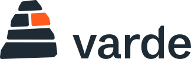

<h1 align="center">
  <picture>
    <source media="(prefers-color-scheme: dark)" srcset="brand/svg/varde-logo-dark.svg" />
    
  </picture>
</h1>

<p align="center">Game servers built by many hands.</p>

[](https://github.com/grendalaget/varde/actions/workflows/ci.yml)
[](https://github.com/grendalaget/varde/releases)
[](LICENSE)

[Website](https://varde.games) | [Download](https://varde.games/download) | [Documentation](https://varde.games/docs)

Peer-hosted game servers for groups of friends. One active host at a time,
replicated snapshots, automatic failover, stable loopback service addresses,
and a P2P QUIC mesh with relay fallback, with no router configuration required.

## Supported games and platforms

Hosting support follows the [game catalog](apps/controlplane/internal/catalog/catalog.json).

| Game | Host operating systems | Host architectures |
| --- | --- | --- |
| Minecraft (Java) | Linux, Windows | x86_64, aarch64 |
| Valheim | Linux, Windows | x86_64 |
| Counter-Strike 2 | Linux, Windows | x86_64 |
| Auto Tournament | Linux, Windows | x86_64 |
| Test Game (development only) | Linux, Windows | x86_64, aarch64 |

macOS cannot host catalog games. Counter-Strike 2 game addons require Linux.
See the [game notes](docs/games/README.md) for runtime requirements and limitations.
Read the [FAQ](docs/faq.md) for client requirements and known limitations.

## Components

| Path                 | Language   | Purpose                                             |
| -------------------- | ---------- | --------------------------------------------------- |
| `apps/controlplane` | Go         | HTTP API, auth, membership, scheduler, rendezvous   |
| `apps/relay`         | Go         | Encrypted packet forwarding only (no game TLS)      |
| `apps/mesh`          | Go         | Per-node QUIC mesh daemon, spawned by the agent     |
| `apps/agent`         | Rust       | Local node agent: supervision, storage, executors   |
| `apps/web`           | TypeScript | Web dashboard (React + Vite)                        |
| `apps/desktop`       | Rust       | Windows tray (Tauri 2): link this PC, status        |
| `go/`                | Go         | Shared libraries (identity, ids, generated protos)  |
| `crates/`            | Rust       | Shared libraries (driver/executor APIs, storage)    |
| `games/`             | Rust       | Game drivers (minecraft, valheim, cs2, autotournament, testgame) |
| `proto/`             | Protobuf   | Wire contracts (mesh IPC, frames, relay)            |
| `api/openapi`        | OpenAPI    | Control-plane HTTP API contract                     |
| `packaging/`         | -          | Linux (nfpm/systemd) and Windows packaging          |

## Install

Get the desktop app from [varde.games/download](https://varde.games/download),
then follow the [hosting guide](https://varde.games/docs/host-a-server).
Current builds are nightly prereleases.

On Linux, one line installs the agent (`--component control-plane|relay` for
the others):

```sh
curl -fsSL https://github.com/grendalaget/varde/releases/download/nightly/install.sh | sh -s -- --version nightly
```

The script picks `.deb`/`.rpm` (or a systemd tarball), verifies the download
against `SHA256SUMS`, and prints next steps. See
[packaging/linux/README.md](packaging/linux/README.md).

## Development

See [docs/development.md](docs/development.md) for toolchain setup, then:

```sh
make gen    # regenerate protobuf + OpenAPI clients
make build  # build everything
make test   # run all tests
make lint   # run all linters
```

## Releases

See [docs/releasing.md](docs/releasing.md) for release/nightly builds, assets,
signing setup and download verification.

## License

[AGPL-3.0-or-later](LICENSE). varde's core technology is free and open
source forever: anyone may run, study, modify and redistribute it, and
anyone offering a modified version to users over a network must share
their source.

Versions prior to October 2026 were released under the MIT License; those
releases remain MIT-licensed.

The Varde name and logos are not covered by the AGPL grant. Forks must use
their own name and logos. See [TRADEMARKS.md](TRADEMARKS.md).

## Community

Read the [contribution guide](CONTRIBUTING.md) and
[code of conduct](CODE_OF_CONDUCT.md). Report vulnerabilities using the
[security policy](SECURITY.md), not public issues.
